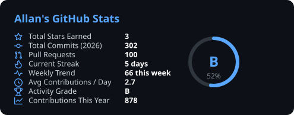
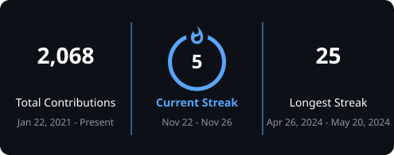
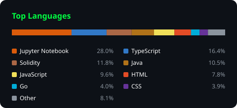
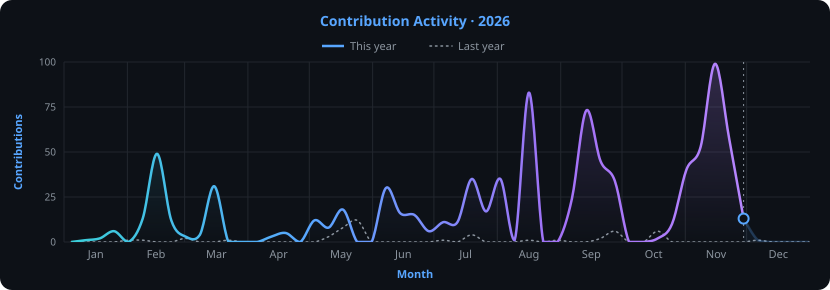
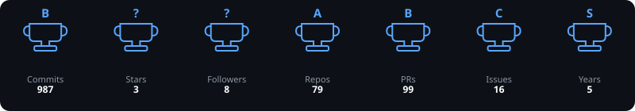

<div align="center">




<p>
  
  
  
</p>

</div>

---

## ` ~ ` `>` `cat ./about.md`

```js
const allan = {
    name:        "Allan Kariuki",
    location:    "Nairobi, Kenya 🇰🇪",
    role:        "Software Engineer — ML, Backend & Web3",
    currently:   ["DawaTrace", "USD-X stablecoin bridge", "English⇄Kiswahili translator"],
    learning:    "Neural networks from scratch (micrograd → makemore)",
    interests:   ["Applied ML / Computer Vision", "Fintech & payments infrastructure", "Blockchain", "Mobile"],
    collaborate: "Open to any interesting project — let's build something!",
    motto:       "Solving problems with every tool within reach.",
};
```

---

## ` ~ ` `>` `ls ./tech_stack/`

<div align="center">

#### `> languages/`


#### `> frameworks_and_tools/`


</div>

---

## ` ~ ` `>` `git log --pinned`

> **`[FLAGSHIP]`** Currently shipping intelligent systems and full-stack platforms.

<table>
<tr>
<td width="50%" valign="top">

#### 🅽 [DawaTrace](https://github.com/AllanKariuki/dawatrace)
```yaml
status:   active
type:     HealthTech · Computer Vision
stack:    Go · Python · PyTorch · Kotlin · PostGIS
about:    On-device CV + GS1/EPCIS track-and-trace
          against counterfeit medicines in
          Kenya / East Africa.
```

</td>
<td width="50%" valign="top">

#### 🅽 [Language Translator](https://github.com/AllanKariuki/language-translator)
```yaml
status:   active
type:     AI / ML
stack:    NLLB-200 · FastAPI · Gradio · CTranslate2
about:    English⇄Kiswahili translation via a
          fine-tuned NLLB-200 model — REPL,
          Gradio demo and FastAPI service.
```

</td>
</tr>
<tr>
<td width="50%" valign="top">

#### 🅽 [Intelligent Parking Assistant](https://github.com/Intelligent-Parking-Assistant/backend)
```yaml
status:   active
type:     ML / Computer Vision
stack:    Python · Django · ML Models
about:    Smart parking system that detects,
          allocates and manages parking using
          vision + ML.
```

</td>
<td width="50%" valign="top">

#### 🅽 [ZenWash Backend](https://github.com/AllanKariuki/zenwashBackend)
```yaml
status:   active
type:     Service Platform API
stack:    Python · Django · REST
about:    Backend for an on-demand car-wash
          booking and dispatch platform.
```

</td>
</tr>
<tr>
<td width="50%" valign="top">

#### 🅽 [Air drums](https://github.com/AllanKariuki/air-drums)
```yaml
status:   active
type:     Computer Vision
stack:    Python · Computer Vision
about:    Simulates playing drums by tracking
          hand movements via webcam and playing
          stored sounds.
```

</td>

</tr>
</table>

<div align="center">
  
  `> 82 public repositories · pinned 5 above · explore more →` **[github.com/AllanKariuki?tab=repositories](https://github.com/AllanKariuki?tab=repositories)**
  
</div>

---

## ` ~ ` `>` `./stats.sh --live`

<div align="center">




<br/>



<br/><br/>



<br/><br/>



</div>

---

## ` ~ ` `>` `./connect.sh --establish`

<div align="center">

<a href="https://www.linkedin.com/in/allan-kariuki-70bbb7186/">
  
</a>
<a href="mailto:allankariuki96@gmail.com">
  
</a>
<a href="https://github.com/AllanKariuki">
  
</a>

</div>

---

<div align="center">

```bash
$ echo "Thanks for stopping by — let's build something that matters."
> Connection closed. EOF.
```


</div>
